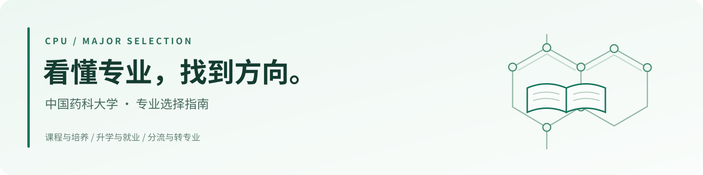

  

<h1 align="center">中国药科大学专业选择指南</h1>

从课程与培养方案出发，了解专业，再作选择。

  <a href="中国药科大学专业选择指南_第1版.md"><b>📖 阅读完整手册</b></a> ·
  <a href="docs/专业目录.md"><b>🧭 按专业阅读</b></a> ·
  <a href="docs/保研考研与分流转专业.md"><b>🎓 升学与分流</b></a> ·
  <a href="docs/参考资料.md"><b>📚 参考资料</b></a>

> **第1版 · 2026年10月29日**  
> 课程依据 **2025级** 官方方案，招生介绍参考 **2026年**，推免名额对应 **2027届**。阅读时请注意入学年级与毕业届别。

## 📖 关于手册

专业名字相近，课程和培养侧重点却可能不同。这份指南面向中国药科大学希望了解专业、参加大类分流或考虑转专业的同学，介绍课程、培养要求与发展方向，帮助读者作出适合自己的选择。

内容包括25个普通专业／方向条目、5类特色班和两个中外合作项目，以及相似专业比较、学习规划、保研考研、专业分流和转专业说明。

## 🧭 阅读入口

| 你想了解什么 | 从这里开始 |
| --- | --- |
| 某个专业学什么、有什么特点 | **[专业目录 →](docs/专业目录.md)** 每个专业单独一页 |
| 从头阅读完整介绍 | **[完整手册 →](中国药科大学专业选择指南_第1版.md)** 含可点击目录 |
| 查询必修课、选修课和课程编号 | **[课程索引 →](docs/2025级课程摘录索引.md)** 按专业展开 |
| 保研条件、成绩公式和专业名额 | **[升学与分流 →](docs/保研考研与分流转专业.md)** |
| 拔尖创新班怎样选拔、与拔尖基地有何区别 | **[特色班选拔 →](docs/特色班选拔与基地培养.md)** 按适用年级阅读 |
| 查看官方依据 | **[参考资料 →](docs/参考资料.md)** 培养方案及政策原文 |

## 📚 怎样使用

建议先看培养目标与必修课程，再比较学习特点和发展方向。专业选择应同时考虑个人兴趣、基础、实践偏好与升学计划。

> [!NOTE]
> 课程、制度与名额附官方来源；学习代价、适合人群和方向建议供个人参考。课程摘录对应所标明的培养方案年级，实际修读及办理要求以学校正式文件为准。

## 📂 阅读与下载

| 形式 | 适用场景 |
| --- | --- |
| [分专业阅读](docs/专业目录.md) | 手机阅读、快速比较某个专业 |
| [完整手册](中国药科大学专业选择指南_第1版.md) | 连续阅读、全文检索 |
| [下载阅读包](中国药科大学专业选择指南_第1版_资料包.zip) | 本地保存、离线阅读、分享给同学 |

## 致谢

手册结构参考[竹野·Zephyr的HITWH专业分流介绍手册](https://github.com/zephyr0903-wh/HITWH-major-selection)。课程与政策依据中国药科大学教务处、招生部门及各学院公开文件，具体链接见[参考资料](docs/参考资料.md)。
